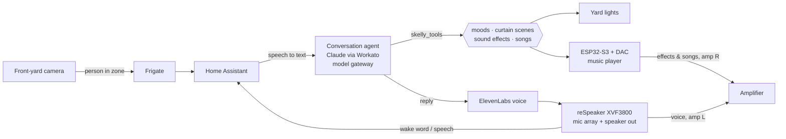

# Skelly 💀🎃

A 12-foot front-yard skeleton that **talks with trick-or-treaters**. Skelly
notices people walking up, greets them in his own voice, listens, and answers
— in character, with his own light show, sound effects and songs. Built on
[Home Assistant](https://www.home-assistant.io/), [ESPHome](https://esphome.io/),
Frigate person detection and an LLM conversation agent (Claude, directly or
through the Workato model gateway).

> "Skelly... two hundred years I've guarded this yard. And who dares walk up my
> driveway tonight?"

## What he can do

- **Hands-free conversations.** The front-yard camera sees someone step into a
  zone at the end of the driveway, and Skelly speaks first, then keeps
  listening as long as his replies end in a question. Visitors can also wake
  him with **"Hey Skelly"** or **"Hello Skelly"** — custom wake words trained
  for this project (including on kids' voices, so small children can wake him).
- **A character with rules.** Spooky-but-kind for little kids, scarier for
  teens and adults, drops the act if a child is upset. Never invites anyone
  inside, never promises candy before Halloween night, never reveals anything
  about the family, and never asks for names.
- **Stage effects on his own initiative.** Changes the yard lights to a mood,
  plays animated scenes on the light curtains behind him, fires sound effects
  (a wolf howl for a werewolf costume), and performs his own songs.
- **Personalities.** A dropdown switches who he is: Halloween (the default),
  Unhinged (a roast comic on Grok), a Workato demo, and Christmas (coming). All of
  them are bound by the same safety rules, and each can have its own voice and tools.
- **No house control.** Skelly's agent gets a purpose-built tool API, never
  Home Assistant's Assist API, so a stranger on the driveway can change the
  yard lights and play sounds, and nothing else.

## How it works



- **Ears and voice:** a Seeed reSpeaker XVF3800 4-mic array (with a XIAO
  ESP32-S3) running ESPHome as a Home Assistant voice satellite. Its echo
  cancellation lets Skelly listen while he talks.
- **Music player:** an ESP32-S3 with a PCM5102A I2S DAC, a second ESPHome media
  player for sound effects and songs on a separate speaker.
- **Conversation agent:** Claude, reached directly or through the Workato model
  gateway (the **model route** dropdown), with the prompt built from
  `homeassistant/personas/` and the `skelly_tools` LLM API.

## Repository layout

| Path | What's there |
|---|---|
| `esphome/` | Device configs for the reSpeaker satellite and the music player, the raven wake chime |
| `esphome/wakeword/` | The **Hello Skelly** and **Hey Skelly** microWakeWord models, plus the Colab cells used to train them |
| `homeassistant/custom_components/skelly_tools/` | The LLM API Skelly's agent gets: `set_yard_mood`, `play_curtain_scene`, `play_sound`, `play_song`, `stop_song`, `show_workato`, plus `sensor.skelly_tools` |
| `homeassistant/custom_components/skelly_workato/` | The Workato model gateway route: a streaming conversation agent for Workato's AI Gateway |
| `homeassistant/personas/` | Skelly's personalities (character, voice, tools) and model routes |
| `homeassistant/prompts/` | The shared prompt layout and safety rules every personality keeps |
| `homeassistant/scripts/`, `automations/`, `packages/` | Greeting, mood lighting, personality and model-route switching, helpers |
| `homeassistant/dashboards/` | The dashboard section that controls him |
| `media/effects/` | Ten short public-domain / CC0 sound effects ([credits](media/CREDITS.md)) |
| `suno/` | Prompts for Skelly's songs (generate your own in Suno) |
| `tools/skelly.py` | Deploy prompts, scripts, automations, the component and media to Home Assistant; run test conversations |
| `docs/` | [Hardware & wiring](docs/hardware.md), [wake words](docs/wake-words.md), [agents & safety](docs/agents.md) |

## Getting started

1. **Hardware** — see [docs/hardware.md](docs/hardware.md).
2. **ESPHome** — copy `esphome/secrets.yaml.example` to `esphome/secrets.yaml`,
   fill it in, then flash both boards:
   `esphome run esphome/skelly-voice.yaml` and `esphome run esphome/skelly-music.yaml`.
   Add both to Home Assistant through the ESPHome integration.
3. **Home Assistant** — install the package and component, then deploy:
   ```bash
   pip install -r tools/requirements.txt
   export HA_URL=http://homeassistant.local:8123 HA_TOKEN=... HA_SSH=root@homeassistant.local
   cp homeassistant/personal.example.yaml homeassistant/personal.yaml   # your own gravestones etc.
   python tools/skelly.py deploy-component      # then restart Home Assistant
   python tools/skelly.py deploy-media
   python tools/skelly.py deploy-scripts
   python tools/skelly.py deploy-automations
   ```
4. **Agents** — create the conversation agents listed in
   `homeassistant/personas/routes.yaml`, then build the personalities, dropdowns
   and voice pipelines: `python tools/skelly.py deploy-personas`. See
   [docs/agents.md](docs/agents.md).
5. **Talk to him** — `python tools/skelly.py test conversation.skelly_workato`,
   or say "Hey Skelly".

This is one house's build, so the scripts reference that house's lights
(Govee curtain lights, roofline and spotlights) — adapt the entity IDs in
`homeassistant/scripts/skelly_mood.yaml` and `skelly_tools` to your own.

## Privacy

Skelly talks to strangers, including children. The prompts forbid asking for
or repeating names and personal details, and the family's own details stay
out of this repo: personal touches (like the gravestone text) live in a
git-ignored `homeassistant/personal.yaml` that the deploy tool swaps in.
Conversation transcripts stay in Home Assistant.
